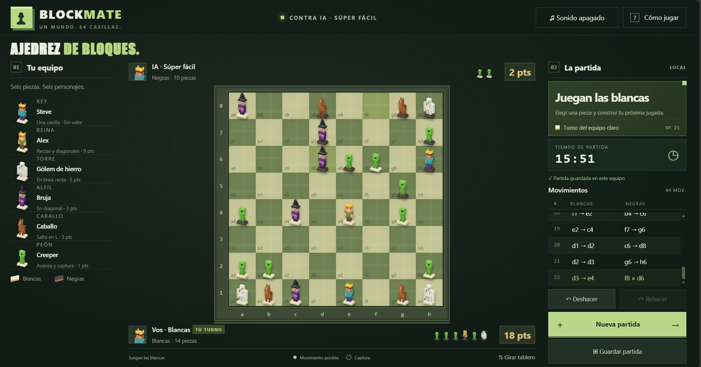

# BLOCKMATE · Ajedrez de Minecraft

Ajedrez local para una persona contra IA o dos personas en la misma computadora. El núcleo está implementado en Java 21 y la interfaz web dibuja personajes con bloques en Canvas 2D.



## Ejecutar

Requiere JDK 21 y Maven. `java` y `javac` deben estar disponibles en PATH. `run.ps1` busca Maven en PATH o una distribución local descargada por el IDE. La primera compilación puede necesitar Internet para descargar dependencias; el juego funciona localmente.

1. Ejecutar **Jugar.bat** desde el Explorador de archivos de Windows.
2. Esperar el mensaje “Ajedrez de bloques listo”.
3. Abrir **http://127.0.0.1:8080** y elegir modo y nivel.
4. Mantener la consola abierta. Usar Ctrl+C para detener el servidor.

Desde PowerShell:

```powershell
.\run.ps1
.\run.ps1 -Port 8081
.\run.ps1 -Console
```

Si el puerto está ocupado, elegir otro y abrir la dirección correspondiente. Si no se reconoce `javac`, comprobar la instalación del JDK y volver a abrir la terminal. La carpeta `web/` debe permanecer junto al proyecto: el JAR no contiene la interfaz embebida.

## Jugar

Seleccionar una pieza y luego un destino resaltado. El tutorial interactivo permite consultar movimientos y reglas sin alterar la partida. En modo solo el humano usa blancas y la IA negras; en dos jugadores no interviene la IA.

- Reglas estándar de 8 × 8: jaque, mate, ahogado, enroque, al paso y cuatro promociones.
- Historial, capturas, destinos legales, deshacer y rehacer. En solo se revierten normalmente la jugada humana y la respuesta de la IA.
- Puntaje por capturas: peón 1, caballo 3, alfil 3, torre 5 y reina 9. El rey no se captura y los puntos no determinan al ganador.
- Guardado automático y manual; recuperación del estado y de la posibilidad de rehacer.
- Cronómetro general de tiempo activo: pausa al ocultar o cerrar el juego y continúa al volver. Varias vistas no duplican el tiempo.
- Interfaz adaptable a 390 px, giro del tablero y sonido local opcional.

Teclado: Tab recorre controles; Enter o Espacio los activa; las flechas recorren casillas y Escape quita la selección o cierra un diálogo. La consola acepta `e2 e4`, `deshacer`, `rehacer`, `salir` y promociones como `a7 a8 KNIGHT`. La consola inicia una partida básica nueva, sin la sesión persistente de la web.

La IA es local y didáctica. Ofrece cinco niveles; los superiores usan minimax con poda alfa-beta y límites de profundidad, nodos y tiempo. No tiene clasificación Elo ni utiliza aprendizaje automático. Sus presupuestos internos no garantizan un tiempo de respuesta universal.

## Guardado y límites

La web guarda en `data/current-match.properties`. Las pestañas del mismo servidor comparten una partida; usar un solo servidor por archivo. Para respaldar, detener el servidor y copiar el archivo a una ubicación independiente. No se versionan las partidas personales.

El servidor recibe actividad cada 5 segundos y la vence a los 15 segundos si el navegador desaparece sin avisar. Al reiniciar espera una vista activa. Un corte abrupto puede perder los segundos posteriores al último guardado. Los archivos antiguos se migran tomando su última escritura como referencia, porque no registraban pausas.

La escritura usa un temporal y reemplazo atómico cuando está disponible. Ante un fallo se revierte la operación; un archivo corrupto se rechaza sin sobrescribirlo silenciosamente.

La partida es local, sin cuentas ni multijugador por Internet. La triple repetición y los 50 movimientos producen tablas automáticas; se detectan casos básicos de material insuficiente. No hay reclamaciones de torneo, rendición, tablas por acuerdo ni importación/exportación PGN. El historial usa notación descriptiva, no SAN completa. El alcance se detalla en [requisitos](docs/requisitos.md).

## Pruebas

```powershell
mvn test
mvn package
.\run.ps1 -Test
```

La suite contiene **65 pruebas JUnit 5**: 31 de reglas, 16 de funcionalidades, 4 de validación, 2 de trayectorias, 9 de actividad y 3 de Memento. `mvn clean test` aprobó las 65 el 2/11/2026, sin fallos, errores ni omisiones. La [evidencia de Memento](docs/evidencias/2026-11-02-memento/README.md) identifica las fuentes probadas. La campaña de 62 pruebas del 31/10 se conserva como registro histórico.

Las herramientas opcionales de navegador requieren Node, Playwright y Chrome. Reinician la partida: ejecutarlas solamente contra un servidor de prueba con archivo separado. [Calidad y reproducción](docs/calidad-y-metricas.md).

## Documentación

[Índice de documentación](docs/README.md): alcance, requisitos, arquitectura, patrones, UML, calidad, rendimiento, riesgos, dependencias e informe técnico. El [estado de revisión](docs/integridad-y-cierre.md) reúne los pendientes vigentes. Las evidencias mantienen su fecha y commit originales.

## Organización del código

```text
src/main/java/ar/edu/ajedrez/
  core/board/       Tablero y coordenadas
  core/pieces/      Piezas, tipos, colores y fábrica
  core/movement/    Contrato y seis estrategias de movimiento
  core/validation/  Legalidad, jaque y motivos de rechazo
  core/game/        Partida, comandos e historial
  core/session/     Sesión, reloj y puerto de persistencia
  core/ai/          Puerto de IA, niveles y minimax
  app/              Web, consola y composición
  app/persistence/  Adaptador de archivo
src/test/           Cinco suites JUnit
web/                Interfaz y personajes Canvas
docs/               Documentación y evidencias
tools/              Verificación y medición opcionales
```

Los gráficos voxel se generan localmente; no se descargan modelos oficiales. Proyecto académico inspirado en Minecraft, sin afiliación con Mojang o Microsoft. [Recursos y atribución](docs/dependencias-y-recursos.md).
